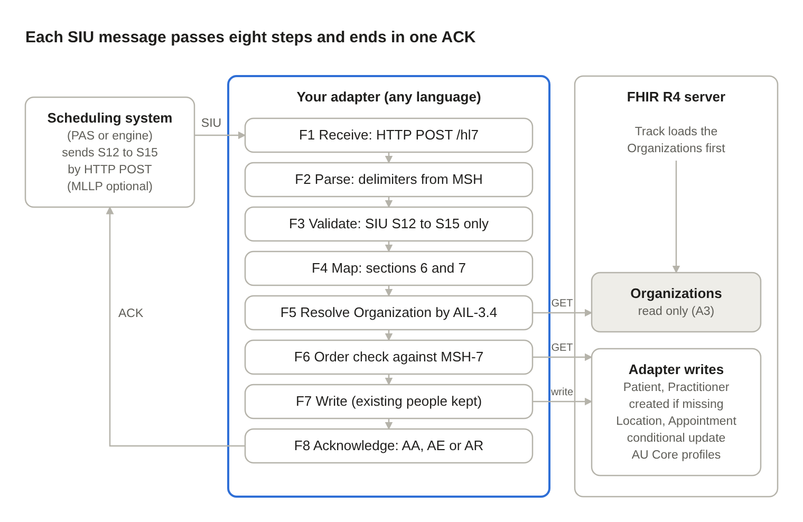

# Adapter Specification - HL7 v2 SIU to FHIR Appointment - AU Core (Proof of Concept) v0.1.0

* [**Table of Contents**](toc.md)
* **Adapter Specification**

## Adapter Specification

# Track 2B: SIU to FHIR Appointment Adapter Specification

Oct 26, 2026 · @DFF

## 1. Purpose and scope

Track 2B participants build an **adapter** that receives HL7 v2 SIU scheduling messages and keeps a FHIR R4 server's appointments up to date, producing resources that conform to **AU Core 2.0.0**. Build it in any language; this document is the contract your adapter is tested against.

A reference implementation in Python (`siu-fhir-au-core`) behaves exactly as described here, and its sample messages and expected results are the Track 2B test set (section 9).

| | |
| :--- | :--- |
| SIU events S12 (new booking), S13 (reschedule), S14 (modification), S15 (cancellation) | Other SIU events (S16–S26) and other message types: reject them |
| HTTP POST input with HL7 acknowledgements; MLLP input is optional | Security: no authentication or TLS is required |
| Writing Appointment, Patient, Practitioner and Location; referencing existing Organizations | Slot and Schedule resources |
| AU Core 2.0.0 for Patient, Practitioner, Location, Organization; a track profile for Appointment | Querying or displaying appointments (that is the front end's job) |

All test data is **simulated**. IHI, HPI-I and Medicare numbers in the samples are synthetic: they pass the AU Base format checks but were not issued to anyone.

The keywords SHALL, SHOULD and MAY are used as in RFC 2119: SHALL is required to pass the track, SHOULD is expected unless you note why not, MAY is optional.

## 2. Assumptions and preconditions

The key assumption: **every facility's Organization is already on the FHIR server** before any SIU message arrives, with an identifier whose system is `http://example.org/fhir/sid/organization` and whose value equals the facility code sent in AIL-3.4. The adapter looks these up and never changes them.

| | | |
| :--- | :--- | :--- |
| A1 | FHIR R4 (4.0.1) server reachable over REST | A shared HAPI FHIR server is provided at the event; its base URL is given at kick-off. Base URL is configurable, e.g.`http://localhost:8080/fhir`for local testing |
| A2 | Server supports search by`identifier`, conditional update (`PUT [type]?identifier=…`) and conditional create (`If-None-Exist`) | All standard FHIR R4 REST interactions |
| A3 | Organizations are pre-loaded (above) | Example: Organization "Simulated Hospital" with identifier`http://example.org/fhir/sid/organization`|`SIMHOSP`, plus its address. The track supplies them as a transaction Bundle |
| A4 | Messages are HL7 v2.5 SIU, pipe-delimited (ER7), one message per HTTP request body (or MLLP frame) | Delimiters are read from MSH, never assumed |
| A5 | Sender follows Australian v2 conventions for national identifiers | IHI`^^^AUSHIC^NI`, Medicare`^^^AUSHIC^MC`, HPI-I XCN.13`NPI`, Medicare provider number XCN.9`AUSHICPR` |
| A6 | Timestamps without a UTC offset are local time in a configured zone | Default`Australia/Brisbane`(+10:00, no daylight saving) |
| A7 | The adapter is the only writer of Appointments for these messages | Each message rebuilds the whole Appointment |

If an Organization is missing despite A3, the adapter SHALL either create a placeholder Organization (section 6.8) or reject the message with AE; the choice is the team's. State which option you chose when you register for the track.

## 3. Architecture overview

 [embedded content: adapter architecture · 3 components, 8 steps]

Messages arrive by HTTP POST; MLLP is an optional extra. The adapter never changes an existing Organization, Patient or Practitioner: it references the server's copy as is. It creates a Patient or Practitioner only when none matches, and an Organization placeholder only for teams that choose that option (F5). Locations and the Appointment are written with conditional updates, so a replayed message changes nothing. A front end reads the server directly and is outside this track.

## 4. Functional requirements

The adapter SHALL perform F1–F8 for every message, in order, and SHALL send exactly one acknowledgement per message whatever happens.

| | | |
| :--- | :--- | :--- |
| F1 | Receive | SHALL accept one raw HL7 message in the body of an HTTP POST and return its ACK in the response (section 5.1). MAY also listen for MLLP on a configurable TCP port (2575 by default), accepting several messages on one connection (section 5.2) |
| F2 | Parse | SHALL read the delimiters from MSH-1 and MSH-2; split segments on CR (also accept LF and CRLF); split fields, repetitions, components and sub-components; decode escapes`\F\``\S\``\T\``\R\``\E\`. Field numbers follow HL7: MSH-1 is the field separator |
| F3 | Validate | SHALL reject (`AR`) anything that is not SIU or not S12–S15. SHALL return`AE`for required data missing or invalid (section 8) and write nothing |
| F4 | Map | SHALL build Patient, Practitioner(s), Location(s) and the Appointment as in section 6, and apply the code mappings in section 7 |
| F5 | Resolve Organizations | For each distinct AIL-3.4 facility code: SHALL search`Organization?identifier=http://example.org/fhir/sid/organization\|<code>`and use the result**unchanged**. If none exists, SHALL either create a placeholder with conditional create and log a warning, or reject the message with AE (team's choice; section 8) |
| F6 | Order check | SHALL find any existing Appointment by its identifier. If the stored source message time (extension, section 6.9) is later than this message's MSH-7, SHALL acknowledge`AA`and change nothing |
| F7 | Write | For the Patient and each Practitioner, SHALL search on the match identifier and, if one exists, reference it unchanged (SHALL NOT update it); if none exists, SHALL create it with conditional create. SHALL write Locations with conditional update, then the Appointment (update by id if it exists, otherwise conditional update). Replaying a message SHALL NOT create duplicates |
| F8 | Acknowledge | SHALL return an original-mode ACK (section 5.3):`AA`on success or stale message,`AE`on data or server errors,`AR`on rejection |
| F9 | Log | SHOULD log each message's control ID, outcome and every warning (dropped identifiers, placeholders, untranslated codes) |

The adapter SHOULD process messages one at a time (or serialise per appointment) so two messages for the same appointment cannot race.

## 5. Interfaces

### 5.1 HTTP (primary)

Send each message as the body of `POST <adapter base URL>/hl7`, one message per request. Segments MAY be separated by CR, LF or CRLF. The response SHALL carry the original-mode ACK (section 5.3), with this HTTP status:

| | |
| :--- | :--- |
| 200 | ACK is`AA`(including a stale message, F6) |
| 422 | ACK is`AE`or`AR` |
| 400 | Empty or oversized body; no ACK can be built |

The adapter SHOULD also answer `GET /health` with 200, so hosting platforms and test tools can check it is up. The reference implementation returns JSON: the ACK in `ack` (segments separated by LF for readability), plus `appointment`, `resources` and `warnings`. Teams MAY return the ACK as plain text instead.

HTTP is the primary interface because many hosting services expose only HTTP(S); a Render web service, for example, routes public traffic to one HTTP port only. Example: `curl --data-binary @01_s12_book.hl7 https://<adapter>/hl7` (on Windows PowerShell, `curl.exe --data-binary "@01_s12_book.hl7" …`).

### 5.2 MLLP (optional)

If offered, each message is framed as `0x0B` + message + `0x1C 0x0D`, with segments separated by CR (`0x0D`). The ACK goes back on the same connection in the same framing. Several messages MAY arrive on one connection; process and acknowledge them in order.

### 5.3 Acknowledgement

Original-mode ACK, segments separated by CR:

```
MSH|^~\&|<your app>|<your facility>|<MSH-3>|<MSH-4>|<now, YYYYMMDDHHMMSS+ZZZZ>||ACK^<MSH-9.2>^ACK|<new control id>|<MSH-11, else P>|<MSH-12, else 2.5>
MSA|<AA|AE|AR>|<received MSH-10>
ERR|||<code>^<text>^HL70357|E||||<readable explanation>

```

* The ERR segment is sent only with `AE` or `AR`; section 8 lists the codes.
* Any `|`, `^`, `~`, `\` or `&` in the explanation SHALL be escaped.
* If the message couldn't be parsed at all, use the default delimiters and leave the echoed fields empty.

### 5.4 FHIR REST interactions

All requests use `Accept` and `Content-Type: application/fhir+json`; writes SHOULD send `Prefer: return=representation`. For one message, in this order:

| | | |
| :--- | :--- | :--- |
| 1 | `GET Appointment?identifier=<system>\|<value>` | Find the existing Appointment (filler ID, else placer ID) for F6 |
| 2 | `GET Organization?identifier=http://example.org/fhir/sid/organization\|<AIL-3.4>` | Per facility; use the result as is |
| 2a | `POST Organization`with header`If-None-Exist: identifier=…` | Only when step 2 found nothing and the team creates placeholders |
| 3 | `GET Patient?identifier=<system>\|<value>` | First usable PID-3 identifier is the match key; if found, use it as is |
| 3a | `POST Patient`with header`If-None-Exist: identifier=…` | Only when step 3 found nothing |
| 4 | `GET Practitioner?identifier=<system>\|<value>` | Per active AIP with an ID and family name; if found, use it as is |
| 4a | `POST Practitioner`with header`If-None-Exist: identifier=…` | Only when step 4 found nothing |
| 5 | `PUT Location?identifier=<system>\|<value>` | Per active AIL with location parts |
| 6 | `PUT Appointment/<id>`, or`PUT Appointment?identifier=…`if new | Write the rebuilt Appointment |

In token searches, escape `|`, `,`, `$` and `\` inside the system or value with a backslash, then URL-encode the whole parameter. A conditional update or create that matches more than one resource fails (HTTP 412), and a Patient or Practitioner search that returns more than one match is ambiguous: treat both as a server error (`AE`, code 207).

## 6. Detailed mapping

Every message rebuilds the whole Appointment from that message; Patient, Practitioner and Location are rebuilt and overwritten too. Field numbers are HL7 v2.5; `X-n.m.s` = field n, component m, sub-component s.

### 6.1 Conventions

**Identifier systems.** `{c}` is a code taken from the message, percent-encoded; an empty code becomes `default`.

| | | | |
| :--- | :--- | :--- | :--- |
| Appointment, filler ID | `http://example.org/fhir/sid/appointment/filler/{SCH-2.2, else SCH-2.3}` | SCH-2.1 | v2-0203`FILL` |
| Appointment, placer ID | `http://example.org/fhir/sid/appointment/placer/{SCH-1.2, else SCH-1.3}` | SCH-1.1 | v2-0203`PLAC` |
| Patient MRN (PID-3.5 =`MR`) | `http://example.org/fhir/sid/mrn/{PID-3.4}` | PID-3.1 | v2-0203`MR` |
| Patient, other local IDs | `http://example.org/fhir/sid/patient/{PID-3.4}/{PID-3.5, else id}` | PID-3.1 | v2-0203`{PID-3.5}`if present |
| IHI, Medicare, HPI-I, provider number | Fixed national systems (section 7.6) |   |   |
| Practitioner, local ID | `http://example.org/fhir/sid/practitioner/{AIP-3.9}` | AIP-3.1 | none |
| Location | `http://example.org/fhir/sid/location` | AIL-3.4 / AIL-3.1 / AIL-3.2 / AIL-3.3, empty parts skipped, joined with`/`(e.g.`SIMHOSP/OPD/CLINIC1`) | none |
| Organization (lookup only) | `http://example.org/fhir/sid/organization` | AIL-3.4 | none |

The filler ID is the Appointment's match key; the placer ID is used only when SCH-2 is empty. If both are empty the message gets `AE`.

**Date-times.** HL7 DTM is `YYYY[MM[DD[HH[MM[SS[.S…]]]]]][+/-ZZZZ]`. Missing parts default to the start of the period. Keep a given offset; otherwise apply the configured time zone. Write FHIR dateTime with the offset, e.g. `2026-10-14T09:30:00+10:00`. A value that doesn't parse, or has an impossible part (month 13), is an error (`AE`, 102).

**Coded fields (CE).** CE.1 → `coding.code`; CE.2 → `coding.display` and `text` (`text` = CE.1 if CE.2 is empty). For `coding.system`:

* CE.3 = `HL70276` → `http://terminology.hl7.org/CodeSystem/v2-0276`
* any other CE.3 → `http://example.org/fhir/CodeSystem/v2-local/{CE.3}`
* CE.3 empty → no system

**Resource segments.** An AIS, AIG, AIL or AIP whose segment action code (field 2) is `D` is ignored entirely. Any other value, or none, counts as active. RGS segments are ignored and all groups are flattened into one Appointment.

**Durations.** Units come from CE.1, case-insensitive: s/sec/second(s); min/mins/minute(s); h/hr/hrs/hour(s); d/day(s). Empty units mean minutes, with a warning. A non-numeric, negative or infinite amount, or an unknown unit, is an error (`AE`, 102).

### 6.2 Appointment

Profile: SIU AU Appointment (`http://example.org/fhir/siu2fhir-au/StructureDefinition/siu-au-appointment`), set in `meta.profile`.

| | | |
| :--- | :--- | :--- |
| SCH-2, SCH-1 | `identifier[]` | Filler first, then placer (6.1) |
| SCH-25 + trigger event | `status` | Section 6.3 |
| SCH-6 | `cancelationReason` | CE → CodeableConcept, only when`status`=`cancelled` |
| SCH-7 | `appointmentType` | CE → CodeableConcept |
| AIS-3 (each active AIS) | `serviceType[]` | CE → CodeableConcept |
| SCH-11.4.1 | `start` | Else the earliest AIS-4 / AIG-8 / AIL-6 / AIP-6 of active segments |
| SCH-11.5.1 | `end` | Else`start`+ SCH-9 (units SCH-10); else the latest resource start + its duration (AIS-7/8, AIG-11/12, AIL-9/10, AIP-9/10) |
| (computed) | `minutesDuration` | Whole minutes from`start`to`end`, rounded down |
| NTE-3 (all NTE segments) | `comment` | Joined with a newline, in message order |
| PID, AIP, AIL, AIG | `participant[]` | Section 6.4 |
| MSH-7 | `extension`source-message-datetime (`valueDateTime`) | Used by the order check (F6) |
| MSH-10 | `extension`source-message-control-id (`valueString`) | Traceability |
| SCH-8, SCH-12 to SCH-24, SCH-26/27, TQ1 | not mapped |   |

End before start is an error (`AE`, 101). FHIR R4 rule app-3 needs both `start` and `end` unless the status is `proposed`, `cancelled` or `waitlist`, so a message without them gets `AE` (101).

Extension URLs: `http://example.org/fhir/siu2fhir-au/StructureDefinition/source-message-datetime` and `…/source-message-control-id`.

### 6.3 Appointment status

| | | |
| :--- | :--- | :--- |
| S12 | Mapped value (section 7.1) | `booked` |
| S13, S14 | Mapped value | Status of the existing Appointment (`booked`if new) |
| S15 | `cancelled` | `cancelled` |

An unrecognised SCH-25 code is logged as a warning, not rejected.

### 6.4 Participants

In this order, each with `status` = `accepted`:

1. **Patient**:
* `actor.reference` = the Patient
* `actor.display` = given names + family name from the first named entry
* `required` = `required`

1. **Each active AIP**:
* With an ID (AIP-3.1) and a family name (AIP-3.2): `actor.reference` = the Practitioner, `actor.display` = prefix + given + family.
* Otherwise: `actor.display` only (the name, or `Unidentified personnel`).
* `type` from AIP-4 (section 7.3).

1. **Each active AIL**:
* With any of AIL-3.1 to AIL-3.4: `actor.reference` = the Location, `actor.display` = its name.
* Otherwise: `actor.display` only (AIL-3.9, or `Unidentified location`).

1. **Each active AIG with a value in AIG-3**:
* `actor.display` = AIG-3.2, else AIG-3.1. No resource is created.
* `type` from AIG-4 (section 7.3).

### 6.5 Patient (PID)

Profile: AU Core Patient (`http://hl7.org.au/fhir/core/StructureDefinition/au-core-patient`), set in `meta.profile`.

This mapping is used only to create a Patient that isn't on the server yet. If a Patient with the match identifier (the first usable PID-3 identifier) already exists, the adapter references it unchanged (F7), and the Appointment's patient `actor.display` SHOULD come from that Patient's name.

| | | |
| :--- | :--- | :--- |
| PID-3, each repetition | `identifier[]` | By PID-3.5 / PID-3.4, see the table below. The first identifier kept is the match key |
| PID-5, each repetition with a family or given name | `name[]` | `family`= XPN.1.1;`given`= [XPN.2, XPN.3];`prefix`= XPN.5;`suffix`= XPN.4;`use`=`official`when XPN.7 =`L`;`text`= prefix, given, family, suffix joined with spaces |
| (no family name in any name) | extra`name`entry | `{"extension":[data-absent-reason = unknown]}`and nothing else (AU Core rules au-core-pat-02 and -03) |
| PID-7 | `birthDate` | Precision kept (YYYY, YYYY-MM or YYYY-MM-DD; any time dropped). Empty →`_birthDate`with data-absent-reason`unknown`. Invalid →`AE`(102) |
| PID-8 | `gender` | Section 7.2. Empty →`unknown`(AU Core requires gender) |
| PID-10.1 | `extension`indigenous-status | Section 7.5 |
| PID-11, each repetition | `address[]` | `line`= [XAD.1.1, XAD.2];`city`= .3;`state`= .4;`postalCode`= .5;`country`= .6; normalised as in section 7.7;`text`= "line, city, state postcode" |
| PID-13 / PID-14 | `telecom[]` | Email when XTN.4 is set and XTN.3 =`Internet`or`X.400`, or XTN.2 =`NET`. Otherwise phone: XTN.1, else XTN.6 + space + XTN.7.`use`=`home`(PID-13) or`work`(PID-14);`mobile`when XTN.3 =`CP` |
| PID-15 | `communication[0].language` | `text`= CE.2 or CE.1. Add`coding`system`urn:ietf:bcp:47`, code = CE.1 in lower case, only when CE.3 is`ISO639`,`ISO639-1`,`BCP47`or`IETF` |

**PID-3 identifiers**, checked in this order for each repetition:

| | |
| :--- | :--- |
| PID-3.5 =`NI`, or PID-3.4 =`AUSHIC`and value starts`800360` | IHI (7.6). If the value fails the IHI check, drop it and warn |
| PID-3.5 =`MC` | Medicare (7.6). Not 10–11 digits → drop and warn. PID-3.8 →`period.end` |
| PID-3.4 =`AUSDVA` | Kept as a local identifier (6.1) with a warning: SIU carries no DVA entitlement type, which the AU DVA Number profile requires |
| PID-3.5 =`MR` | MRN (6.1). No`assigner` |
| anything else | Local identifier (6.1) |

If no identifier survives, the message gets `AE` (101): AU Core rule au-core-pat-01.

### 6.6 Practitioner (AIP-3)

Profile: AU Core Practitioner. A Practitioner is created only when AIP-3.1 **and** AIP-3.2 (family name, required by AU Core) are present; otherwise the participant is display-only and a warning is logged.

This mapping is used only to create a Practitioner that isn't on the server yet. If a Practitioner with the match identifier already exists, the adapter references it unchanged (F7), and the participant's `actor.display` SHOULD come from that Practitioner's name.

| | | |
| :--- | :--- | :--- |
| AIP-3.1 with XCN.13 =`NPI`, or XCN.9 =`AUSHIC`and value starts`800361` | `identifier`HPI-I (7.6) | Fails the HPI-I check → local identifier instead, with a warning |
| AIP-3.1 with XCN.9 =`AUSHICPR` | `identifier`Medicare provider number (7.6) |   |
| AIP-3.1, other | `identifier`local (6.1) |   |
| AIP-3.2.1, AIP-3.3, AIP-3.6 | `name[0]` | `family`,`given`,`prefix`;`text`= prefix given family |
| AIP-4 | (on the Appointment participant) | Section 7.3 |

### 6.7 Location (AIL-3)

Profile: AU Core Location. One Location per distinct AIL-3 combination; same combination = same Location.

| | | |
| :--- | :--- | :--- |
| AIL-3.4, .1, .2, .3 | `identifier` | 6.1 (satisfies AU Core rule au-core-loc-01) |
| AIL-3.9 | `name` | Else the AIL-3 parts joined with spaces |
| (constant) | `status` | `active` |
| AIL-4 | `type[0]` | Translated through the track's location type table (7.4) when listed; else CE → CodeableConcept and a warning |
| AIL-3.3 / .2 / .1 | `physicalType` | Most specific part present: bed →`bd`, room →`ro`, point of care →`wa`(7.4) |
| AIL-3.4 → Organization from F5 | `managingOrganization` | `reference`= the server's Organization;`display`= its`name` |
| That Organization's`address[0]` | `address` | Copied as is when the Organization has an address |

### 6.8 Organization (lookup, never written)

The adapter SHALL NOT update an existing Organization. Teams that create placeholders (F5) use this when no Organization exists for a facility code:

```
{"resourceType": "Organization",
 "meta": {"profile": ["http://hl7.org.au/fhir/core/StructureDefinition/au-core-organization"],
          "tag": [{"system": "http://example.org/fhir/siu2fhir-au/CodeSystem/siu2fhir-tag", "code": "placeholder"}]},
 "identifier": [{"system": "http://example.org/fhir/sid/organization", "value": "<AIL-3.4>"}],
 "name": "<AIL-3.4>", "active": true}

```

It is created with `POST Organization` and `If-None-Exist: identifier=http://example.org/fhir/sid/organization|<AIL-3.4>`, so it can never be duplicated. A Location under a placeholder has no address.

## 7. Code set mappings

Code matching is case-insensitive unless stated.

### 7.1 SCH-25 filler status (HL7 table 0278) → Appointment.status

| | | |
| :--- | :--- | :--- |
| Pending | `pending` |   |
| Waitlist | `waitlist` |   |
| Booked | `booked` |   |
| Started | `arrived` | The HL7 v2-to-FHIR IG uses`checked-in`; this track uses`arrived` |
| Complete | `fulfilled` |   |
| Cancelled | `cancelled` |   |
| Discontinued (v2.3+), DC (v2.9+) | `cancelled` | Both spellings SHALL be accepted |
| Deleted | `entered-in-error` |   |
| Blocked, Overbook | `booked` | No exact FHIR equivalent |
| Noshow | `noshow` |   |

### 7.2 PID-8 administrative sex (table 0001) → Patient.gender

| | |
| :--- | :--- |
| M | `male` |
| F | `female` |
| O, A | `other` |
| U, N, any other value, empty | `unknown` |

### 7.3 AIP-4 / AIG-4 role → participant.type

Codes in the FHIR participant-type value set go to their own code system; anything else follows the CE rule (6.1).

| | |
| :--- | :--- |
| ADM, ATND, CALLBCK, CON, DIS, ESC, REF, SPRF, PPRF, PART | `http://terminology.hl7.org/CodeSystem/v3-ParticipationType`(code in upper case) |
| translator, emergency | `http://terminology.hl7.org/CodeSystem/participant-type`(code in lower case) |

`text` = CE.2 when present.

### 7.4 Location type and physical type

* **AIL-4 → `Location.type`.** Use the track's translation table, which maps local codes to ServiceDeliveryLocationRoleType - AU Extended. The table is supplied at the event and may be empty. A code not in the table is sent as a local code, with a warning.
* **`Location.physicalType`.** System `http://terminology.hl7.org/CodeSystem/location-physical-type`, using the most specific AIL-3 part present: 
* bed (AIL-3.3) → `bd` "Bed"
* room (AIL-3.2) → `ro` "Room"
* point of care (AIL-3.1) → `wa` "Ward"
 

### 7.5 PID-10 → Indigenous status

When PID-10.1 is `1`, `2`, `3`, `4` or `9`, add the Patient extension below. Any other value is not mapped, and a warning is logged.

```
{"url": "http://hl7.org.au/fhir/StructureDefinition/indigenous-status",
 "valueCoding": {"system": "https://healthterminologies.gov.au/fhir/CodeSystem/australian-indigenous-status-1", "code": "<PID-10.1>"}}

```

### 7.6 National identifiers (AU Base 6.0.0)

| | | | |
| :--- | :--- | :--- | :--- |
| IHI | `http://ns.electronichealth.net.au/id/hi/ihi/1.0` | v2-0203`NI` | 16 digits, starts`800360`, Luhn check passes |
| Medicare card number | `http://ns.electronichealth.net.au/id/medicare-number` | v2-0203`MC` | 10 or 11 digits |
| HPI-I | `http://ns.electronichealth.net.au/id/hi/hpii/1.0` | v2-0203`NPI` | 16 digits, starts`800361`, Luhn check passes |
| Medicare provider number | `http://ns.electronichealth.net.au/id/medicare-provider-number` | `http://terminology.hl7.org.au/CodeSystem/v2-0203``UPIN` | none |

v2-0203 = `http://terminology.hl7.org/CodeSystem/v2-0203`. Luhn: from the rightmost digit, double every second digit, subtract 9 from any result over 9, and sum all digits; the total must be divisible by 10.

### 7.7 Australian address normalisation (PID-11)

Apply when the country is `AU`, `AUS` or `Australia`, or empty with an Australian state. This shapes the address for the AU Base Australian Address profile:

* **Country:** `AU`, `AUS` or `Australia` → `AU`.
* **State:** a full name becomes its code (`Queensland` → `QLD`). Valid codes are ACT, NSW, NT, QLD, SA, TAS, VIC and WA. Any other value is kept as sent, with a warning.
* **Postcode:** must be 4 digits. Any other value is kept as sent, with a warning.
* **Text:** `text` is always set, so the profile's "text or line" rule holds.

An address that still can't meet the profile is a valid plain Address in AU Core.

## 8. Error handling and acknowledgement codes

Every message gets exactly one ACK. On `AE` or `AR` nothing from that message is written (an Organization placeholder already created may remain).

| | | |
| :--- | :--- | :--- |
| Applied | `AA` | none |
| Older than the stored source message time (F6) | `AA` | none; log it |
| Can't be parsed (doesn't start with MSH, bad segment name) | `AR` | `207^Application internal error` |
| MSH-9.1 is not`SIU` | `AR` | `200^Unsupported message type` |
| MSH-9.2 is not S12–S15 | `AR` | `201^Unsupported event code` |
| Required data missing: no SCH, no PID, no appointment ID, no usable patient identifier, no start/end where status needs them, end before start, no Organization for an AIL-3.4 facility code (teams that reject, F5) | `AE` | `101^Required field missing` |
| Invalid value: bad date-time (MSH-7 excepted), bad birth date, non-numeric / negative / infinite duration, unknown duration unit | `AE` | `102^Data type error` |
| FHIR server unreachable or returns an error (including 412 multiple matches) | `AE` | `207^Application internal error` |
| Any unexpected error in the adapter | `AE` | `207^Application internal error` |

ERR-4 = `E`; ERR-8 carries a readable explanation, e.g. `PID-7: Invalid HL7 date 'UNKNOWN'`.

These are **warnings, not errors**. The message is accepted (`AA`) and the warning is logged:

* Invalid IHI, HPI-I or Medicare number (dropped or kept as local).
* DVA number kept as local.
* Missing family name, birth date or sex (data-absent rules).
* AIP without a family name.
* Unrecognised SCH-25.
* Untranslated AIL-4 code.
* Unrecognised PID-10.
* Address that can't be normalised.
* Empty duration units.
* Unparseable MSH-7: the order check is skipped for that message.
* Organization placeholder created (placeholder option).

## 9. Test scenarios and conformance checklist

Run these against an empty server with only Organization `SIMHOSP` loaded (assumption A3). Send the messages in order by HTTP POST (or MLLP, if offered); the results below come from the reference implementation.

### 9.1 Sample messages

```
01  MSH|^~\&|PAS|SIMHOSP|SIU2FHIR|POC|20261007090000+1000||SIU^S12^SIU_S12|MSG0001|P|2.5
    SCH|PLC1001^PAS|FIL2001^SCHED|||||FOLLOWUP^Follow-up^HL70276|Normal^Normal^HL70277|30|min|^^^20261014093000+1000^20261014100000+1000||||||||||||||Booked
    PID|1||900001^^^SIMHOSP^MR~8003609900001239^^^AUSHIC^NI~29999999991^^^AUSHIC^MC||TESTPATIENT^ALICE^^^MS^^L||19800101|F||4^Neither Aboriginal nor Torres Strait Islander origin^AUSINDIGENOUS|1 Example Street^^BRISBANE^QLD^4000^AU||^PRN^PH^^^00^00000000~^NET^Internet^alice@example.org||en^English^ISO639
    RGS|1|A
    AIS|1|A|GPCONS^General consultation^LOCAL
    AIL|1|A|OPD^CLINIC1^^SIMHOSP^^^^^Outpatient Clinic 1|CLIN^Clinic^LOCAL
    AIP|1|A|8003619900004562^SMITH^JANE^^^DR^^^AUSHIC^^^^NPI|ATND^Attending^LOCAL

02  As 01, except: MSH-7 20261007091000+1000, MSH-9 SIU^S13^SIU_S12, MSH-10 MSG0002, RGS|1|U,
    SCH|PLC1001^PAS|FIL2001^SCHED||||PATREQ^Patient request^LOCAL|FOLLOWUP^Follow-up^HL70276||30|min|^^^20261015110000+1000^20261015113000+1000||||||||||||||Booked

03  MSH|^~\&|PAS|SIMHOSP|SIU2FHIR|POC|20261007092000+1000||SIU^S14^SIU_S12|MSG0003|P|2.5
    SCH|PLC1001^PAS|FIL2001^SCHED|||||FOLLOWUP^Follow-up^HL70276||30|min|^^^20261015110000+1000^20261015113000+1000
    NTE|1||Interpreter required (Mandarin)
    PID  (as 01)
    RGS|1|U
    AIS, AIL  (as 01)
    AIP|1|D|8003619900004562^SMITH^JANE^^^DR^^^AUSHIC^^^^NPI
    AIP|2|A|2426621B^JONES^RAJ^^^DR^^^AUSHICPR|ATND^Attending^LOCAL

04  MSH|^~\&|PAS|SIMHOSP|SIU2FHIR|POC|20261007093000+1000||SIU^S15^SIU_S12|MSG0004|P|2.5
    SCH|PLC1001^PAS|FIL2001^SCHED||||PATCANC^Patient cancelled^LOCAL|FOLLOWUP^Follow-up^HL70276||30|min|^^^20261015110000+1000^20261015113000+1000||||||||||||||Cancelled
    PID, RGS|1|U, AIS, AIL  (as 03)
    AIP|1|U|2426621B^JONES^RAJ^^^DR^^^AUSHICPR|ATND^Attending^LOCAL

05  MSH|^~\&|PAS|SIMHOSP|SIU2FHIR|POC|20261007094000+1000||SIU^S12^SIU_S12|MSG0005|P|2.5
    SCH|PLC1002^PAS|FIL2002^SCHED|||||ROUTINE^Routine^HL70276
    PID|1||900002^^^SIMHOSP^MR||TESTPATIENT^BOB^^^MR^^L||19751231|M
    RGS|1|A
    AIS|1|A|PHYSIO^Physiotherapy^LOCAL|20261016140000|||45|min
    AIL|1|A|OPD^PHYSIO1^^SATELLITE^^^^^Physio Room 1

06  MSH|^~\&|PAS|SIMHOSP|SIU2FHIR|POC|20261007095000+1000||SIU^S12^SIU_S12|MSG0006|P|2.5
    SCH|PLC1003^PAS|FIL2003^SCHED|||||||15|min|^^^20261017090000+1000^20261017091500+1000||||||||||||||Booked
    PID|1||900003^^^SIMHOSP^MR~8003609900001230^^^AUSHIC^NI||^CHARLIE
    RGS|1|A
    AIS|1|A|GPCONS^General consultation^LOCAL
    AIP|1|A|P9999^^ANON|ATND^Attending^LOCAL

```

The public [reference repository](https://github.com/healthinfoservices/siu-fhir-au-core) holds each message as a complete file in its samples folder, with CR segment terminators.

### 9.2 Expected results

| | | | |
| :--- | :--- | :--- | :--- |
| TC-01 | 01 (S12) | AA | Appointment FIL2001`booked`, 2026-10-14 09:30–10:00 +10:00, 30 min. Patient 900001 with MRN (`…/mrn/SIMHOSP`), IHI, Medicare, Indigenous status`4`, language`en`. Practitioner Dr Jane Smith with HPI-I. Location`SIMHOSP/OPD/CLINIC1`:`physicalType``ro`, managed by Simulated Hospital, address copied. Role`ATND`in v3-ParticipationType |
| TC-02 | 02 (S13) | AA | Same Appointment, now 2026-10-15 11:00–11:30; still`booked`; no`cancelationReason` |
| TC-03 | 03 (S14) | AA | Dr Smith removed (action`D`); Dr Raj Jones added with Medicare provider number 2426621B, type`UPIN`;`comment`"Interpreter required (Mandarin)"; still`booked` |
| TC-04 | 04 (S15) | AA | `cancelled`,`cancelationReason`"Patient cancelled" |
| TC-05 | 01 again | AA | Ignored as stale (MSH-7 earlier than stored); FIL2001 stays`cancelled` |
| TC-06 | 05 (S12) | AA | Facility SATELLITE not on server → one placeholder Organization (tag`placeholder`). Location`SATELLITE/OPD/PHYSIO1`with no address. FIL2002 2026-10-16 14:00–14:45 +10:00 (default time zone, AIS timing). Teams that reject instead: AE with ERR-3 101, and nothing from message 05 is written |
| TC-07 | 06 (S12) | AA | Patient 900003: IHI dropped (fails Luhn),`gender``unknown`,`_birthDate`data-absent-reason, names = [given CHARLIE] + [data-absent-reason only]. No Practitioner; participant display "ANON". FIL2003 09:00–09:15 |
| TC-08 | Any sample, each message twice | AA | No duplicate resources |
| TC-09 | 01 with MSH-9`ADT^A01` | AR | ERR-3 200; nothing written |
| TC-10 | 01 with MSH-9`SIU^S26` | AR | ERR-3 201 |
| TC-11 | 01 with PID-7`UNKNOWN` | AE | ERR-3 102; nothing written |
| TC-12 | 06 with SCH-9, SCH-10 and SCH-11 emptied | AE | ERR-3 101 (no start/end for a`booked`appointment) |
| TC-13 | On a fresh server with SIMHOSP loaded, first load a Patient with MRN 900001 (system …/mrn/SIMHOSP) named Alicia Testpatient-Smith, and a Practitioner with HPI-I 8003619900004562 named Dr Jane Curated; then send 01 | AA | Both kept exactly as loaded; no second Patient or Practitioner. The Appointment references them, with their names as actor display |

After TC-01 to TC-08 the server holds 3 Patients, 2 Practitioners, 2 Locations, 2 Organizations (SIMHOSP and the SATELLITE placeholder) and 3 Appointments. With the reject option: 2 Patients, 2 Practitioners, 1 Location, 1 Organization and 2 Appointments.

### 9.3 Conformance checklist

* TC-01 to TC-13 give the expected ACK and server state
* Patient, Practitioner, Location and Organization validate against AU Core 2.0.0; Appointment against SIU AU Appointment
* Existing Organizations, Patients and Practitioners are never modified (TC-13)
* One ACK per message over HTTP (and MLLP, if offered), including on unexpected errors
* Delimiters read from MSH, escapes decoded
* Warnings logged for every case listed in section 8

## 10. Open questions and references

### 10.1 Known deviations and open items

These are deliberate choices for the track or are still unconfirmed. Raise them at the track kick-off rather than changing behaviour on your own.

| | | |
| :--- | :--- | :--- |
| 1 | SCH-7 →`appointmentType`(SCH-8 unmapped). The HL7 v2-to-FHIR IG maps SCH-7 →`reasonCode`and SCH-8 →`appointmentType` | Track choice; FHIR R4 binds`appointmentType`to table 0276, SCH-7's table |
| 2 | Resource-segment timing rolled up into`Appointment.start`/`end`; the v2-to-FHIR IG uses`participant.period` | Track simplification |
| 3 | Table 0278`Started`→`arrived`(IG:`checked-in`);`Blocked`/`Overbook`→`booked`(IG: unmapped) | Track choice |
| 4 | Australian v2 identifier conventions (A5) and PID-10 for Indigenous status | Confirm with real senders |
| 5 | Code values not yet checked against the published sets: Australian States and Territories, Indigenous status codes, location-physical-type`bd`/`ro`/`wa` | Unverified |
| 6 | Canonical URLs of AU Core Practitioner, Location and Organization assumed from the confirmed AU Core Patient pattern | Unverified |
| 7 | `example.org`identifier systems and the IG canonical are placeholders | By design for the track |
| 8 | The track IG and reference implementation have not yet been validated with the HL7 IG Publisher or against a running HAPI server | First build pending |
| 9 | Existing Patients and Practitioners are never updated, so demographic changes in later messages are not stored. Patients are matched on the first usable PID-3 identifier only, so a server Patient without that identifier gets a duplicate | Track choice |
| 10 | HTTP response body format (JSON with an ack member, or the plain-text ACK) is not fixed | Team's choice |

### 10.2 References

* [AU Core 2.0.0](https://hl7.org.au/fhir/core/) and its [General Requirements](https://hl7.org.au/fhir/core/general-requirements.html) (missing data, Must Support)
* [AU Core Patient](https://hl7.org.au/fhir/core/StructureDefinition-au-core-patient.html), [Practitioner](https://hl7.org.au/fhir/core/StructureDefinition-au-core-practitioner.html), [Location](https://hl7.org.au/fhir/core/StructureDefinition-au-core-location.html), [Organization](https://hl7.org.au/fhir/core/StructureDefinition-au-core-organization.html)
* AU Base 6.0.0: [IHI](https://hl7.org.au/fhir/6.0.0/StructureDefinition-au-ihi.html), [Medicare card number](https://hl7.org.au/fhir/6.0.0/StructureDefinition-au-medicarecardnumber.html), [HPI-I](https://hl7.org.au/fhir/6.0.0/StructureDefinition-au-hpii.html), [Medicare provider number](https://hl7.org.au/fhir/6.0.0/StructureDefinition-au-medicareprovidernumber.html), [DVA number](https://hl7.org.au/fhir/6.0.0/StructureDefinition-au-dvanumber.html), [Australian Address](https://hl7.org.au/fhir/6.0.0/StructureDefinition-au-address.html), [Indigenous Status extension](https://hl7.org.au/fhir/6.0.0/StructureDefinition-indigenous-status.html)
* [FHIR R4 Appointment](https://hl7.org/fhir/R4/appointment-definitions.html) and [AppointmentStatus](https://hl7.org/fhir/R4/valueset-appointmentstatus.html); [participant type value set](https://hl7.org/fhir/R4/valueset-encounter-participant-type.html)
* HL7 v2 tables: [0278](https://hl7.org/fhir/R4/v2/0278/index.html), [0276](https://hl7.org/fhir/R4/v2/0276/index.html), [0203](https://hl7.org/fhir/R4/v2/0203/index.html)
* HL7 v2.5 [Chapter 10, Scheduling](https://www.hl7.eu/HL7v2x/v25/std25/ch10.html) (SCH, AIS, AIG, AIL, AIP; SIU_S12 structure)
* HL7 v2-to-FHIR IG: [SCH → Appointment](https://hl7.org/fhir/uv/v2mappings/ConceptMap-segment-sch-to-appointment.html), [0278 → AppointmentStatus](https://hl7.org/fhir/uv/v2mappings/ConceptMap-table-hl70278-to-appointmentstatus.html)
* [Representation of common Australian identifiers in v2 and CDA](https://healthintersections.com.au/2020/07/29/representation-of-common-australian-identifiers-in-v2-and-cda.html) (source for A5)
* Reference implementation and track IG: `siu-fhir-au-core` public GitHub repository [github.com/healthinfoservices/siu-fhir-au-core](https://github.com/healthinfoservices/siu-fhir-au-core): service, sample messages, FSH IG, seed Organizations. The track IG is published at [healthinfoservices.net/efiq-track2b](https://healthinfoservices.net/efiq-track2b/index.html)

